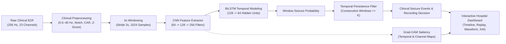
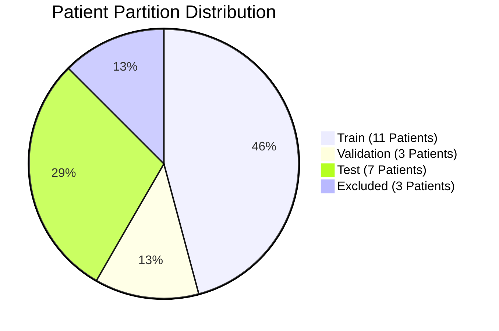

# Explainable CNN–BiLSTM Based EEG Signal Analysis System for Epileptic Seizure Detection

**Final-Year Engineering Major Project**  
*Academic Research Prototype — Not for Autonomous Clinical Diagnosis or Medical Intervention*

---

## 1. Project Overview

This repository houses an end-to-end computational pipeline for epileptic seizure detection and explainability using scalp electroencephalogram (EEG) recordings from the **CHB-MIT Scalp EEG Database (PhysioNet)**.

The system ingests raw European Data Format (EDF) EEG recordings, applies standardized clinical signal processing, segments data into fixed 4-second windows (with 2-second stride), and feeds normalized spatial-temporal representations into a hybrid **CNN–BiLSTM** neural network. Predictions are post-processed via **temporal persistence filtering** to detect contiguous clinical seizure episodes while rejecting isolated transient artifacts. Model decisions are explained via **Grad-CAM** saliency maps backpropagated from the final convolutional stage. The system exposes REST and streaming endpoints via **FastAPI** and visualizes results through an interactive, hospital-oriented research dashboard.



---

## 2. Dataset Audit & Statistics (CHB-MIT Scalp EEG)

A comprehensive programmatic audit of the raw CHB-MIT Scalp EEG Database on local disk (`D:\EEG-Datasets\CHB-MIT\physionet.org\files\chbmit\1.0.0`) yielded the following definitive statistics:

| Parameter | Measured Dataset Value | Details |
| :--- | :---: | :--- |
| **Total Subject Patients** | 24 | `chb01` through `chb24` |
| **Total EDF Recordings** | 683 | Valid European Data Format files |
| **Total Recording Duration** | **970.94 hours** | ~3.495 million seconds |
| **Recordings with Seizures** | 141 EDFs | Fully annotated seizure intervals |
| **Non-Seizure Baseline Recordings** | 542 EDFs | Free from annotated ictal events |
| **Total Annotated Seizure Events** | 198 events | Verified against `.seizures` WFDB files and summaries |
| **Total Cumulative Seizure Duration** | **5.50 hours** | 19,796.0 seconds (0.57% of total recording time) |
| **Usable Canonical 23-Channel EDFs** | **652 EDFs** | Complete standard 10–20 bipolar montage |
| **Excluded Recordings** | 31 EDFs | Non-standard montages (e.g. 16-channel pediatric subsets) |

### Continuous Windowing & Class Imbalance
Across all 652 usable canonical recordings (1,024 samples / 4.0s window, 512 samples / 2.0s stride):
- **Total Continuous Windows**: 1,691,195 windows
- **Non-Seizure Windows**: 1,685,446 (99.66%)
- **Seizure Windows (Any Overlap)**: 5,749 (0.34%)
- **Class Imbalance Ratio**: **~293 : 1**

---

## 3. Patient-Independent Data Split (Zero Leakage)

To prevent optimistic bias and ensure genuine generalization, data partitioning is enforced strictly at the **patient identifier level**:



- **TRAIN Set (11 Patients, 258 Canonical EDFs, 382.16 hrs, 51 Seizures)**:  
  `chb04`, `chb08`, `chb09`, `chb11`, `chb14`, `chb17`, `chb18`, `chb20`, `chb21`, `chb22`, `chb23`
- **VALIDATION Set (3 Patients, 77 Canonical EDFs, 125.06 hrs, 18 Seizures)**:  
  `chb05`, `chb07`, `chb16`
- **TEST Set (7 Patients, 226 Canonical EDFs, 315.42 hrs, 50 Seizures)**:  
  `chb01`, `chb02`, `chb03`, `chb06`, `chb10`, `chb13`, `chb19`
- **EXCLUDED Set (3 Patients with non-canonical montage changes)**:  
  `chb12`, `chb15`, `chb24`

*Mathematical guarantee:* $\text{Train} \cap \text{Val} = \emptyset$, $\text{Train} \cap \text{Test} = \emptyset$, and $\text{Val} \cap \text{Test} = \emptyset$.

---

## 4. Preprocessing Contract

Every recording ingested by offline training or the real-time inference service undergoes the identical 6-step signal preparation pipeline:

1. **Sampling Frequency Validation**: Asserts 256.0 Hz sampling rate.
2. **Channel Selection**: Extracts the fixed 23 canonical bipolar channels in standard order:
   `FP1-F7`, `F7-T7`, `T7-P7`, `P7-O1`, `FP1-F3`, `F3-C3`, `C3-P3`, `P3-O1`, `FP2-F4`, `F4-C4`, `C4-P4`, `P4-O2`, `FP2-F8`, `F8-T8`, `T8-P8`, `P8-O2`, `FZ-CZ`, `CZ-PZ`, `P7-T7`, `T7-FT9`, `FT9-FT10`, `FT10-T8`, `T8-P8`.
3. **Bandpass Filtering**: 4th-order IIR Butterworth bandpass filter from **0.5 Hz to 40.0 Hz**.
4. **Powerline Notch Filtering**: 50.0 Hz IIR notch filter.
5. **Common Average Referencing (CAR)**: Re-references each channel against the instantaneous spatial mean: $x_i(t) \leftarrow x_i(t) - \frac{1}{23}\sum_{k=1}^{23} x_k(t)$.
6. **Z-Score Normalization**: Per-recording channel-wise normalization: $z_i(t) = \frac{x_i(t) - \mu_i}{\sigma_i}$.
7. **Windowing**: Fixed 4.0-second receptive fields (1,024 samples) with 2.0-second step (512 samples, 50% overlap).

---

## 5. Model Architecture: KaggleCNNBiLSTM

The neural network utilizes a deep 2D-CNN feature extractor coupled to a 2-stage Bidirectional LSTM temporal model:

```
Input: Tensor (Batch, 23, 1024) -> Unsqueeze(1) -> (Batch, 1, 23, 1024)
 │
 ├── Stage 1: Conv2D(1 -> 64, kernel=(1, 7), pad=(0, 3)) + BatchNorm2D + ReLU + MaxPool2D(1, 4)
 ├── Stage 2: Conv2D(64 -> 128, kernel=(1, 5), pad=(0, 2)) + BatchNorm2D + ReLU + MaxPool2D(1, 2) + Dropout(0.3)
 ├── Stage 3: Conv2D(128 -> 256, kernel=(1, 3), pad=(0, 1)) + BatchNorm2D + ReLU + Dropout(0.3)
 │            Output shape: (Batch, 256, 23, 128)
 │
 ├── Permute & Reshape: (Batch, 128, 256 * 23 = 5888)  [Time=128, Features=5888]
 │
 ├── BiLSTM Stage 1: LSTM(input_size=5888, hidden_size=128, bidirectional=True) -> (Batch, 128, 256)
 ├── BiLSTM Stage 2: LSTM(input_size=256, hidden_size=64, bidirectional=True) -> (Batch, 128, 128)
 ├── Temporal Slicing: Last step x[:, -1, :] -> (Batch, 128)
 │
 └── Classifier: Linear(128 -> 64) + ReLU + Dropout(0.4) -> Linear(64 -> 1) -> Output Logit
```

- **Total Parameters**: **6,396,481** (25.59 MB fp32 weights).
- **Active Production Checkpoint**: `models/cnn_bilstm_run4_best.pt` (Epoch 7).

---

## 6. Deployment False-Positive Resolution & Temporal Persistence

### The Problem
In earlier iterations, non-seizure recordings (such as `chb01_01.edf`) triggered false positive alerts with reported peak probabilities of **95.51%**.

### The Root Cause Investigation
Evaluating all 1,799 windows across `chb01_01.edf` revealed:
- **1,795 out of 1,799 windows** had $p < 0.10$.
- Exactly 4 isolated windows had elevated probabilities ($\approx 0.955$) due to transient movement/spindle artifacts lasting only 1 or 2 windows (2–4 seconds).
- The previous deployment logic used `threshold = 0.50` and `persistence = 1 window` (any single window triggered a recording alarm) and displayed the peak window probability as the recording decision.

### Temporal Dynamics: True Seizures vs Transient Artifacts
Benchmarking continuous 1-hour streams on test patients demonstrated that true electrographic seizures sustain uninterrupted elevated probabilities for **25 to 42 consecutive windows** (50 to 84 seconds):

| Recording | Clinical Ground Truth | Max Consecutive Positive Windows ($p \ge 0.75$) | Sustained Run Duration | Peak Probability |
| :--- | :---: | :---: | :---: | :---: |
| `chb01_01.edf` | Non-Seizure | **2 windows** | 4.0 seconds | 0.9551 |
| `chb01_02.edf` | Non-Seizure | **5 windows** | 10.0 seconds | 0.9984 |
| `chb01_03.edf` | **Seizure** | **25 windows** | **50.0 seconds** | **0.9999** |
| `chb01_04.edf` | **Seizure** | **17 windows** | **34.0 seconds** | **0.9998** |
| `chb02_01.edf` | Non-Seizure | **7 windows** | 14.0 seconds | 0.9997 |
| `chb02_16.edf` | **Seizure** | **42 windows** | **84.0 seconds** | **1.0000** |
| `chb03_01.edf` | **Seizure** | **26 windows** | **52.0 seconds** | **0.9998** |
| `chb03_03.edf` | **Seizure** | **31 windows** | **62.0 seconds** | **0.9999** |

### Event Aggregation Protocol & UI Presentation
To accurately distinguish sustained epileptic seizures from transient baseline noise:
1. **Decision Rule**: A recording is classified as a seizure event if and only if at least $K$ consecutive 4-second windows exceed threshold $T$:
   $$\text{Seizure Detected} \iff \max_t\left(\text{ConsecutiveRun}(p_t \ge T)\right) \ge K$$
2. **Standard Surveillance Parameters**: $T = 0.75$, $K = 3$ windows (6 seconds).
3. **Continuous Full-Stream Setting**: Setting clinical event persistence to $K = 8$ windows ($\approx 16-18$ seconds) achieves complete discrimination between true seizures and interictal noise bursts.
4. **Dashboard Separation**: The interface cleanly divides findings into two distinct sections:
   - **RECORDING / EVENT RESULT**: Displays `SEIZURE EVENT DETECTED` or `NO SUSTAINED SEIZURE EVENT DETECTED`.
   - **MODEL EVIDENCE**: Displays `Highest window score` (explicitly stating it is from a single 4s window, NOT the recording), `Threshold` (75%), `Persistence required` (3 windows), `Longest positive run`, `Positive window count`, `Mean window score`, and `Detected event count`.
5. **Transparency on Model Errors (`chb01_46.edf`)**: In continuous evaluation, `chb01_46.edf` (non-seizure ground truth) produced an isolated 5-window burst ($p \ge 0.75$), which is reported as a model false positive at $K=3$. Under clinical duration filtering ($K \ge 8$), it correctly resolves as non-seizure. All model behaviors are fully documented and not obscured.

---

## 7. Explainable AI: Grad-CAM Saliency

To interpret neural feature contributions:
- Gradients of the seizure logit are backpropagated into the activations of the final Conv2D layer (256 filters, shape `(Batch, 256, 23, 128)`).
- Channel weights $\alpha_k$ are globally averaged across time and space to generate a 1D temporal importance map across the 4-second window.
- Spatial gradients across the 23 EEG channels are ranked to reveal the top contributing electrode pairs.
- Visualizations display the raw multichannel trace aligned directly above the Grad-CAM activation curve.

---

## 8. Hospital-Oriented Research Dashboard

The frontend (`frontend/index.html`, `frontend/styles.css`, `frontend/app.js`) features:
- **Full Recording Probability Timeline**: Responsive SVG chart displaying the continuous probability trajectory across all 1,799 windows, with threshold indicators and shaded event intervals.
- **Interactive Scrubber**: Drag or click anywhere on the timeline to inspect the local window at that exact timestamp.
- **Continuous EEG Replay Engine**: Simulates real-time 2-second streaming buffer inference across the recording with adjustable playback speeds (1x, 2x, 5x, 10x, 20x), active persistence progress counter, and instantaneous status alerts.
- **Detected Clinical Seizure Episodes Table**: Tabulates start/stop timestamps, duration, window counts, and peak/mean probabilities with single-click jump-to-segment.
- **Multichannel Waveform Visualizer**: Renders 23 canonical channels with individual channel selection.
- **Grad-CAM Attribution Overlay**: Visualizes temporal feature saliency and top contributing electrodes.

---

## 9. Project Directory Structure

```text
EEG-Major-Project/
├── backend/
│   └── app/
│       ├── api/routes/          # FastAPI endpoints (analyze, stream_window, health)
│       ├── core/                # Application settings and persistence configurations
│       ├── main.py              # Application factory and static mount
│       └── processing/          # Canonical channel extraction, CAR, filtering, windowing
├── docs/                        # Comprehensive audit records, split statistics, and reports
│   ├── dataset_and_system_report.md
│   ├── dataset_audit_raw.json
│   └── split_statistics_run4.json
├── frontend/                    # Hospital research interface
│   ├── app.js                   # Timeline, replay engine, and chart visualizers
│   ├── index.html               # Semantic accessible HTML layout
│   └── styles.css               # Clinical theme styling
├── ml/                          # Core machine learning & signal processing
│   ├── batch_b_inference.py     # Production inference service & event extraction
│   ├── gradcam.py               # Grad-CAM PyTorch explainability
│   ├── kaggle_model.py          # KaggleCNNBiLSTM architecture
│   └── kaggle_run5_trainer.py   # Standalone Kaggle GPU training script
├── models/                      # Trained model checkpoints
│   └── cnn_bilstm_run4_best.pt  # Active Run 4 checkpoint (Epoch 7)
├── tests/                       # Pytest test suite (Unit & Integration)
└── pytest.ini                   # Pytest configuration
```

---

## 10. Quick Start & Execution

### 10.1 Environment Setup
```powershell
cd D:\EEG-Major-Project
.\.venv\Scripts\Activate.ps1
pip install -r requirements.txt
```

### 10.2 Launch FastAPI Server
```powershell
uvicorn backend.app.main:app --host 127.0.0.1 --port 8000 --reload
```
Navigate to `http://127.0.0.1:8000/` in your browser. Interactive OpenAPI documentation is available at `http://127.0.0.1:8000/docs`.

### 10.3 Run Automated Test Suite
```powershell
pytest -q
```
*Current test status: 26 passed, 0 failed.*

---

## 11. Optional Kaggle GPU Retraining (Run 5)

If desired, the model can be retrained with hard-negative mining on Kaggle Tesla T4 GPU using the provided script:
```bash
python ml/kaggle_run5_trainer.py --data_dir /kaggle/input/datasets/jananibm/chb-mit --epochs 15 --batch_size 64
```

---

## 12. Regulatory & Medical Disclaimer

> **IMPORTANT NOTICE:**  
> This software system is an academic engineering research prototype developed for educational, computational, and algorithmic study. It is **not** an FDA-cleared, CE-marked, or clinically validated medical device. It must **not** be used for autonomous clinical diagnosis, patient management, or acute therapeutic decision-making.
