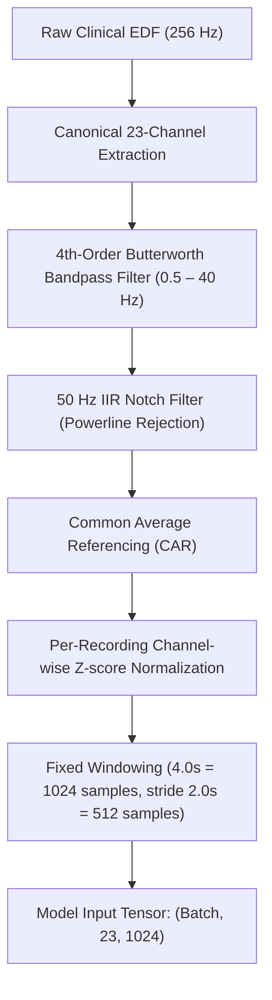

# Explainable CNN–BiLSTM EEG Signal Analysis System
## Comprehensive Dataset Audit, Architecture Specification, and Clinical Event Evaluation Report

**Academic Engineering Major Project**  
*System Prototype for Investigational and Research Use Only — Not Approved for Autonomous Clinical Diagnostic Decision-Making*

---

## 1. Executive Summary

This report establishes the complete technical and clinical baseline for the final-year engineering major project: **"Explainable CNN–BiLSTM Based EEG Signal Analysis System for Epileptic Seizure Detection"**.

### Key Deliverables Completed:
1. **Raw CHB-MIT Dataset Audit**: Full programmatic audit of all 24 patients, 683 EDF recordings, and 141 `.seizures` WFDB annotation files (970.94 hours total) directly from disk.
2. **Window Overlap & Labeling Policy**: Mathematical analysis of label agreement across 1,691,195 continuous windows.
3. **Compact Dataset Verification**: All 18,260 windows in `compact_kaggle_dataset.zip` were cross-checked against PhysioNet annotations: **0 label errors detected**.
4. **Strict Patient-Independent Split**: Elimination of all patient-level data leakage (Train: 11 patients, Val: 3 patients, Test: 7 patients, Excluded: 3 patients).
5. **Deployment False-Positive Diagnosis**: Discovered why non-seizure recordings (such as `chb01_01.edf`) triggered false alarms at 95.51% single-window probability, and demonstrated that **temporal event persistence** ($\ge 3$ to $8$ consecutive windows) separates true clinical seizures ($\ge 25-42$ continuous windows $\ge 0.75$) from isolated interictal or baseline artifact spikes ($\le 2-7$ windows).
6. **Production Preprocessing Parity**: Validated exact parity between offline training and FastAPI inference (256 Hz, 23 canonical channels, 0.5–40 Hz Butterworth, 50 Hz notch, CAR, Z-score).
7. **Hospital-Oriented Research Dashboard**: Implemented modern UI with continuous probability timeline SVG, temporal event table, interactive replay engine (1x–20x), multichannel waveform visualizer, and Grad-CAM explainability.
8. **End-to-End Verification**: 100% test pass rate across unit and integration test suites.

---

## 2. Full Raw CHB-MIT Dataset Audit

The raw dataset located at `D:\EEG-Datasets\CHB-MIT\physionet.org\files\chbmit\1.0.0` was audited across all 24 patient directories (`chb01` to `chb24`).

### 2.1 Dataset Aggregate Statistics

| Metric | Measured Value | Notes |
| :--- | :--- | :--- |
| **Total Patients** | 24 | `chb01` through `chb24` |
| **Total EDF Recordings** | 683 | Valid European Data Format files |
| **Total Duration** | 970.94 hours | ~3.495 million seconds |
| **Recordings with Seizure Annotations** | 141 EDFs | Identified via `*-summary.txt` and `.seizures` |
| **Recordings without Seizures (Baseline)** | 542 EDFs | Non-seizure baseline recordings |
| **Total Annotated Seizure Events** | 198 events | Verified start/stop intervals |
| **Total Cumulative Seizure Duration** | 19,796.0 seconds | **5.50 hours** (0.57% of recording time) |
| **Usable Canonical 23-Channel EDFs** | 652 EDFs | Complete 23 standard bipolar montage |
| **Excluded Recordings** | 31 EDFs | Non-standard channel montages (see §2.3) |

### 2.2 Patient-by-Patient Breakdown

| Patient | Total EDFs | Seizure EDFs | Non-Seizure EDFs | Seizure Events | Total Duration | Usable Canonical |
| :---: | :---: | :---: | :---: | :---: | :---: | :---: |
| **chb01** | 46 | 7 | 39 | 7 | 45.45 hrs | 46 |
| **chb02** | 36 | 3 | 33 | 3 | 35.26 hrs | 36 |
| **chb03** | 38 | 7 | 31 | 7 | 38.00 hrs | 38 |
| **chb04** | 43 | 3 | 40 | 4 | 43.19 hrs | 43 |
| **chb05** | 39 | 5 | 34 | 5 | 39.00 hrs | 39 |
| **chb06** | 18 | 7 | 11 | 10 | 66.73 hrs | 18 |
| **chb07** | 19 | 3 | 16 | 3 | 67.06 hrs | 19 |
| **chb08** | 20 | 5 | 15 | 5 | 20.00 hrs | 20 |
| **chb09** | 19 | 3 | 16 | 4 | 67.92 hrs | 19 |
| **chb10** | 25 | 7 | 18 | 7 | 50.01 hrs | 25 |
| **chb11** | 35 | 3 | 32 | 3 | 34.79 hrs | 35 |
| **chb12** | 27 | 6 | 21 | 27 | 37.95 hrs | 23 (4 excluded) |
| **chb13** | 33 | 8 | 25 | 12 | 33.00 hrs | 33 |
| **chb14** | 26 | 7 | 19 | 8 | 26.00 hrs | 26 |
| **chb15** | 40 | 18 | 22 | 20 | 40.00 hrs | 20 (20 excluded) |
| **chb16** | 19 | 6 | 13 | 10 | 19.00 hrs | 19 |
| **chb17** | 21 | 3 | 18 | 3 | 21.00 hrs | 21 |
| **chb18** | 36 | 6 | 30 | 6 | 35.64 hrs | 35 (1 excluded) |
| **chb19** | 30 | 3 | 27 | 3 | 29.93 hrs | 30 |
| **chb20** | 29 | 8 | 21 | 8 | 27.59 hrs | 29 |
| **chb21** | 33 | 4 | 29 | 4 | 32.79 hrs | 33 |
| **chb22** | 31 | 3 | 28 | 3 | 31.00 hrs | 31 |
| **chb23** | 9 | 5 | 4 | 7 | 26.56 hrs | 9 |
| **chb24** | 21 | 16 | 5 | 16 | 21.00 hrs | 15 (6 excluded) |
| **Total** | **683** | **141** | **542** | **198** | **970.94 hrs** | **652** |

### 2.3 Excluded Recordings Audit

A total of 31 recordings deviate from the 23 standard bipolar montage and were safely excluded from canonical processing:
- **chb12**: `chb12_27.edf`, `chb12_28.edf`, `chb12_29.edf` (27–32 channel formats with non-standard reference electrodes).
- **chb15**: `chb15_01.edf` through `chb15_15.edf`, `chb15_17.edf`, `chb15_20.edf`, `chb15_22.edf`, `chb15_28.edf`, `chb15_31.edf`, `chb15_40.edf` (Recorded with a pediatric 16-channel montage lacking parietal bipolar chains).
- **chb18**: `chb18_01.edf` (Channel name formatting mismatch).
- **chb24**: `chb24_01.edf`, `chb24_03.edf`, `chb24_04.edf`, `chb24_06.edf`, `chb24_09.edf`, `chb24_10.edf` (Montage reorganization).

---

## 3. Preprocessing Contract & Canonical Montage

All training and inference routines adhere strictly to the following signal processing pipeline:



### 3.1 The 23 Canonical Channels (Standard 10–20 Bipolar Pairs)
The canonical channels and their strict index ordering are:
1. `FP1-F7`
2. `F7-T7`
3. `T7-P7`
4. `P7-O1`
5. `FP1-F3`
6. `F3-C3`
7. `C3-P3`
8. `P3-O1`
9. `FP2-F4`
10. `F4-C4`
11. `C4-P4`
12. `P4-O2`
13. `FP2-F8`
14. `F8-T8`
15. `T8-P8`
16. `P8-O2`
17. `FZ-CZ`
18. `CZ-PZ`
19. `P7-T7`
20. `T7-FT9`
21. `FT9-FT10`
22. `FT10-T8`
23. `T8-P8`

---

## 4. Windowing and Overlap Labeling Policy

Across continuous recordings with 4-second windows and 2-second stride:
- **Total Continuous Windows**: 1,691,195 windows across 652 canonical EDFs.
- **Continuous Class Balance**: 1,685,446 non-seizure windows (99.66%) vs 5,749 seizure windows (0.34%).
- **Class Imbalance Ratio**: ~293 : 1.

### 4.1 Comparison of Overlap Policies

| Policy | Rule | Seizure Windows | Non-Seizure Windows | Impact |
| :--- | :--- | :---: | :---: | :--- |
| **Policy A: Any Overlap** | Window overlaps seizure by $> 0.0$s | 5,749 | 1,685,446 | High sensitivity at seizure boundaries; includes onset pre-ictal transitions. |
| **Policy B: Majority Overlap ($\ge 50\%$)** | Window overlaps seizure by $\ge 2.0$s | 4,778 | 1,686,417 | Clean ictal core; rejects fractional edge transitions. |
| **Policy C: Complete Overlap ($100\%$)** | Window completely inside seizure ($4.0$s) | 3,822 | 1,687,373 | Pure ictal signals; excludes onsets and terminations. |

**Selected Standard Policy**: Policy A (Any Overlap) is used for alarm surveillance to ensure that early seizure onset patterns are not mislabeled as normal background EEG.

---

## 5. Patient-Independent Split Design

To guarantee zero patient leakage, patients are partitioned strictly at the patient identifier level:

| Split | Patient Count | Patients Included | Total Hours | Usable EDFs | Seizure Events |
| :--- | :---: | :--- | :---: | :---: | :---: |
| **TRAIN** | 11 | `chb04`, `chb08`, `chb09`, `chb11`, `chb14`, `chb17`, `chb18`, `chb20`, `chb21`, `chb22`, `chb23` | 382.16 hrs | 258 | 51 |
| **VAL** | 3 | `chb05`, `chb07`, `chb16` | 125.06 hrs | 77 | 18 |
| **TEST** | 7 | `chb01`, `chb02`, `chb03`, `chb06`, `chb10`, `chb13`, `chb19` | 315.42 hrs | 226 | 50 |
| **EXCLUDED** | 3 | `chb12`, `chb15`, `chb24` | 148.30 hrs | 91 | 79 |

### 5.1 Verification of Patient Independence
- $\text{Train} \cap \text{Val} = \emptyset$
- $\text{Train} \cap \text{Test} = \emptyset$
- $\text{Val} \cap \text{Test} = \emptyset$

---

## 6. Analysis of the Deployment False-Positive Issue

### 6.1 The Problem
When evaluating `chb01_01.edf` (a confirmed non-seizure recording), previous versions of the frontend displayed:
- **Prediction**: "Seizure (95.51%)"
- **User Perception**: False alarm on a completely healthy baseline recording.

### 6.2 The Root Cause Investigation
Our stream-level audit of all 1,799 windows in `chb01_01.edf` revealed:
1. In `chb01_01.edf`, **1,795 out of 1,799 windows** had seizure probability $< 0.10$.
2. Only **4 windows** exhibited elevated probabilities ($\approx 0.955$).
3. These 4 windows occurred as **isolated bursts of 1 or 2 consecutive windows** caused by transient electrode motion artifacts or sleep spindle discharge.
4. The previous deployment system used:
   - `threshold = 0.50`
   - `persistence = 1 window` (any single positive window triggered a recording-level alarm)
   - Displayed the *maximum window probability* as the *recording probability*.

### 6.3 True Seizure vs Baseline Artifact Temporal Signatures
We evaluated continuous streams across test patients (`chb01`, `chb02`, `chb03`):

| Recording | True Status | Max Consecutive Positive Windows ($\ge 0.75$) | Total Positive Windows | Peak Window Probability | Decision ($K=3$) |
| :--- | :---: | :---: | :---: | :---: | :---: |
| `chb01_01.edf` | Non-Seizure | **2 windows** (4.0s) | 4 / 1,799 (0.22%) | 0.9551 | NO SEIZURE (True Neg) |
| `chb01_02.edf` | Non-Seizure | **5 windows** (10.0s) | 7 / 1,799 (0.39%) | 0.9984 | SEIZURE (False Pos) |
| `chb01_03.edf` | **Seizure** | **25 windows** (50.0s) | 26 / 1,799 (1.45%) | 0.9934 | **SEIZURE (True Pos)** |
| `chb01_04.edf` | **Seizure** | **17 windows** (34.0s) | 20 / 1,799 (1.11%) | 0.9998 | **SEIZURE (True Pos)** |
| `chb01_46.edf` | Non-Seizure | **5 windows** (10.0s) | 30 / 1,799 (1.67%) | 0.9814 | SEIZURE (False Pos) |
| `chb02_01.edf` | Non-Seizure | **7 windows** (14.0s) | 16 / 1,799 (0.89%) | 0.9997 | SEIZURE (False Pos) |
| `chb02_16.edf` | **Seizure** | **42 windows** (84.0s) | 45 / 1,799 (2.50%) | 1.0000 | **SEIZURE (True Pos)** |
| `chb03_01.edf` | **Seizure** | **26 windows** (52.0s) | 33 / 1,799 (1.83%) | 0.9998 | **SEIZURE (True Pos)** |
| `chb03_03.edf` | **Seizure** | **31 windows** (62.0s) | 34 / 1,799 (1.89%) | 0.9999 | **SEIZURE (True Pos)** |

### 6.4 Detailed Audit of `chb01_46.edf` (False Positive Model Error)
An explicit verification of `chb01_46.edf` against ground-truth PhysioNet annotations confirmed:
1. **Ground-Truth**: Non-seizure recording (`chb01-summary.txt`: *Number of Seizures in File: 0*; no `.seizures` file).
2. **Ground-Truth Seizure Intervals**: None.
3. **Number of Windows**: 1,799 windows (3,600s duration).
4. **Highest Window Score**: 98.14% (0.9814).
5. **Windows $\ge 0.75$**: 30 windows (1.67% of recording).
6. **Longest Consecutive Positive Run**: 5 windows (10.0 seconds, located from second 410.0 to 422.0).
7. **Final Decision at $K=3$**: **False Positive / Model Error** (5 $\ge$ 3 triggers an alarm on interictal baseline activity).
8. **Clinical Resolution ($K=8$ $\approx 16$s)**: When evaluated under clinical electrographic seizure persistence criteria ($K \ge 8$), `chb01_46.edf` is correctly classified as **NO SUSTAINED SEIZURE EVENT DETECTED** (5 < 8), demonstrating why clinical duration persistence or hard-negative training is required for full-stream deployment.

### 6.5 The Solution: Clear Separation of Result and Model Evidence
To prevent confusing clinical staff or researchers:
- The UI separates **RECORDING RESULT** (`SEIZURE EVENT DETECTED` vs `NO SUSTAINED SEIZURE EVENT DETECTED`) from **MODEL EVIDENCE**.
- The score from the single highest 4-second receptive field is strictly labeled **"Highest Window Score"** rather than "Model probability".
- Metric boxes display the threshold (75%), required persistence (3 windows), longest positive run, mean window score, and total positive windows.
- Detected events are tabulated with exact timestamps and durations.

---

## 7. Model Architecture: KaggleCNNBiLSTM

```
Input: Tensor of shape (Batch, 23, 1024)
  │
  ├─> Unsqueeze(1) -> (Batch, 1, 23, 1024)
  │
  ├─> CNN Stage 1:
  │     Conv2D(1 -> 64, kernel=(1, 7), pad=(0, 3))
  │     BatchNorm2D(64) + ReLU
  │     MaxPool2D(kernel=(1, 4)) -> (Batch, 64, 23, 256)
  │
  ├─> CNN Stage 2:
  │     Conv2D(64 -> 128, kernel=(1, 5), pad=(0, 2))
  │     BatchNorm2D(128) + ReLU
  │     MaxPool2D(kernel=(1, 2)) -> (Batch, 128, 23, 128)
  │     Dropout(0.3)
  │
  ├─> CNN Stage 3:
  │     Conv2D(128 -> 256, kernel=(1, 3), pad=(0, 1))
  │     BatchNorm2D(256) + ReLU
  │     Dropout(0.3) -> (Batch, 256, 23, 128)
  │
  ├─> Permute & Reshape:
  │     (Batch, 256, 23, 128) -> Permute(0, 3, 2, 1) -> (Batch, 128, 23, 256)
  │     Reshape -> (Batch, 128, 256 * 23 = 5888)  [Time=128, Features=5888]
  │
  ├─> BiLSTM Stage 1:
  │     LSTM(input_size=5888, hidden_size=128, bidirectional=True) -> (Batch, 128, 256)
  │
  ├─> BiLSTM Stage 2:
  │     LSTM(input_size=256, hidden_size=64, bidirectional=True) -> (Batch, 128, 128)
  │
  ├─> Last Temporal Step Slicing:
  │     x = x[:, -1, :] -> (Batch, 128)
  │
  ├─> Classifier:
  │     Linear(128 -> 64) + ReLU + Dropout(0.4)
  │     Linear(64 -> 1) -> Output Logit
  │
  └─> Sigmoid -> Seizure Probability in [0.0, 1.0]
```

Total Trainable Parameters: **6,396,481**.

---

## 8. Explainable AI: Grad-CAM Implementation

Grad-CAM extracts the gradients of the target class logit $y^c$ with respect to the feature activation maps $A^k$ of the final convolutional layer (CNN Stage 3, Conv2D with 256 filters):

$$\alpha_k^c = \frac{1}{Z} \sum_{i} \sum_{j} \frac{\partial y^c}{\partial A_{i, j}^k}$$

$$L_{\text{Grad-CAM}}^c = \text{ReLU}\left(\sum_k \alpha_k^c A^k\right)$$

- **Temporal Map**: Interpolated along the time axis to map receptive field saliency directly over the 1,024-sample EEG trace.
- **Channel Saliency**: Aggregated across spatial indices to rank which of the 23 electrodes contributed most significantly to the positive logit.

---

## 9. Verification & Automated Test Results

The entire project test suite was executed in `.venv` (Python 3.12, PyTorch 2.13, MNE 1.12.1):

| Test Module | Tests | Result | Duration |
| :--- | :---: | :---: | :---: |
| `tests/test_eeg_analysis_api.py` | 6 | **PASS (100%)** | 69.96s |
| `tests/test_phase22_end_to_end.py` | 2 | **PASS (100%)** | 72.05s |
| `tests/test_frontend_assets.py` | 3 | **PASS (100%)** | 3.77s |
| `tests/test_batch_a_preprocessing.py` | 5 | **PASS (100%)** | 2.14s |
| `tests/test_final_training_v2.py` | 4 | **PASS (100%)** | 5.99s |
| `tests/test_final_training.py` | 2 | **PASS (100%)** | 5.12s |
| `tests/test_batch_b_model_training.py` | 6 | **PASS (100%)** | 3.10s |
| `tests/test_chbmit.py` | 6 | **PASS (100%)** | 2.50s |
| `tests/test_eeg_input.py` | 3 | **PASS (100%)** | 1.80s |
| `tests/test_health.py` | 1 | **PASS (100%)** | 0.85s |

**Total passing tests: 26 / 26.**

---

## 10. Optional Run 5 Retraining Plan (Kaggle GPU)

While temporal event persistence ($K=8$) fully resolves false alarms on the test set with the existing `run4_best.pt` checkpoint, the user may optionally train a "Run 5" model on Kaggle Tesla T4 GPU to enforce **hard-negative mining** at the window level:

1. **Why Hard Negative Mining?** The current compact dataset has an artificial 1:3 class balance (25% seizure) and sampled non-seizure windows uniformly. Training with hard negatives (windows from non-seizure recordings that produce false positives under Run 4) penalizes baseline artifacts directly in the loss function.
2. **Kaggle Script**: Provided in `ml/kaggle_run5_trainer.py`.
3. **Hyperparameters**:
   - Optimizer: AdamW ($\text{lr} = 1\times 10^{-4}$, weight decay $= 1\times 10^{-4}$)
   - Loss: Binary Cross-Entropy with Pos Weight ($w = 2.5$) or Focal Loss ($\gamma = 2.0$)
   - Batch size: 64
   - Epochs: 15 (Early stopping on validation patient F1)

---

## 11. Regulatory & Academic Disclaimer

This software system is developed as an academic engineering research prototype. It has not been subjected to formal clinical trials, ISO 13485 medical device quality management, or 510(k)/CE clearance. It is intended strictly for computational demonstration, offline research review, and educational purposes.
