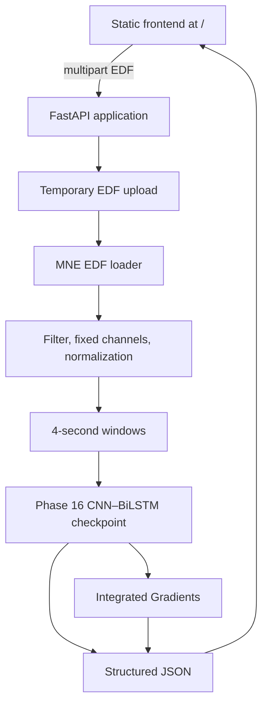

# System Architecture and Workflow

## Components

`POST /api/eeg/analyze` sanitizes the supplied filename, checks the EDF
extension and size, writes the content to a temporary operating-system file,
and deletes that file after success or failure. It loads the configured
development checkpoint through a cached `EEGInferenceService`.

## Workflow/data flow

1. A user selects or drops an EDF file in the frontend.
2. The browser sends `multipart/form-data` to `/api/eeg/analyze`.
3. FastAPI validates the upload and passes the temporary path to existing MNE
   processing code.
4. The Phase 16 policy validates 256 Hz input and a fixed 23-channel CHB01
   layout, then applies preprocessing and four-second/30-second-start windows.
5. The CNN–BiLSTM produces real logits and softmax probabilities per window.
6. The most seizure-probable window receives an Integrated Gradients
   explanation from the actual predicted-class logit.
7. JSON returns segment results, normalized waveform samples, and attribution
   values. The frontend renders those values without generating data itself.

The browser interface is only a research visualization surface; it neither
stores uploads nor alters model output.
